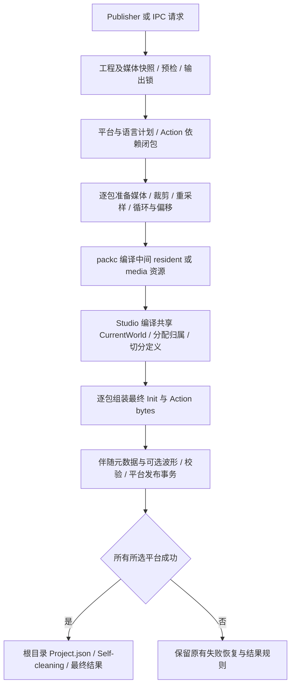

# Studio 打包内部优化报告与实施方案

本轮以保持现有业务行为、使用方式和交付包体完全一致为约束，减少打包中的重复计算、读取与数据复制。基线为 `19ea2c61`，工作分支为 `codex/pack-build-internal-optimization`。同一工程、平台、语言、选择和构建选项下，优化前后的最终 `.bytes` 必须逐字节相同，伴随 JSON 的内容与发布行为也必须保持一致。

## 调查结论

### Wwise 的执行入口与增量机制

本机 Wwise 2024.1.9 的 Console 接受 `.wproj`，能够独立选择 SoundBank、平台和语言并完成构建。Unity 2024.1.6 集成的 Generate SoundBanks 按钮调用 `WwiseConsole generate-soundbank`；Picker 的浏览则分别使用工程文件及生成信息，或连接 Authoring 的 WAAPI。

Wwise 将媒体转换缓存与 SoundBank 增量分开；重建 Bank 不必清除已转换媒体。官方离线帮助描述未变化 Bank 的 Up to Date 状态、多核媒体转换、总体及当前操作进度，以及按 Bank、平台、语言记录的结果。桌面 2026 GUI 反编译还包含独立的 `ISBGenerationProgress` 接口。现有资料不能证明 GUI 每次生成都会启动 Console，也不能给出与 Harken 的同条件性能比值。

本机核查来源：

- `D:/Wwise_Archive/Wwise2024.1.9.8920/Authoring/Data/Schemas/WAAPI/ak.wwise.cli.generateSoundbank.json`
- 同目录的 `ak.wwise.core.soundbank.generate.json`
- `D:/Wwise_Archive/Wwise2024.1.9.8920/Authoring/Help/WwiseHelp_en.chm` 的 Generating SoundBanks、Working with projects 章节
- `C:/Users/XINDONG/Documents/Wwise_Unity_Integration_2024.1.6.3614/Unity.Windows/Wwise/API/Runtime/Handwritten/Common/AkUtilities.cs`
- 同一集成的 `API/Editor/WwiseWindows/AkWwiseProjectInfo.cs`
- `C:/Users/XINDONG/Desktop/Wwise_GUI_2026/WwiseUI/DynamicProgressSoundBanksDlg/AddResultRow.c`

### Harken 当前职责

Studio 创建工程及媒体快照、解析依赖、准备音源，通过 packc 编译中间资源，再在 Studio 内编译 CurrentWorld、切分定义、组装最终包、校验和发布。packc 是资源编译工具，尚不是读取完整工程的项目级执行器。



现有 `packc manifest.json` 接受资源清单，输出位置由清单指定；当前 manifestVersion 为 3，最终包 Schema 为 4。它独立运行时只完成上图中的资源编译步骤。Studio 还负责最终包的逻辑定义、依赖、一致性及发布，因而目前不能仅用 packc 对 `.hsp` 完成整次导出。

| 现有结构 | 影响 | 实现入口 |
|---|---|---|
| 衍生 WAV 是否存在的判断在解码和处理之后 | 缓存命中仍执行媒体计算 | `SoundSourceDerivative::materialize` |
| 同一资源被多个包引用时重复校验和准备 | 增加源文件读取及 PCM 处理 | `ProjectPackExporter::CollectMedia` |
| 每包计算资源指纹时读取 packc 和媒体内容 | 重复读取相同输入 | `PackBuildSession::inputFingerprint` |
| 新旧包最终指纹比较发生在共享编译和切分之后 | 无修改构建仍有较多工作 | `ExportCanonicalPackSet` |
| packc 缓存跟随每次新建并最终删除的暂存输出 | 工具内部缓存通常不能跨导出复用 | `PackcMain.cpp`、`CanonicalPackSetExport.cpp` |
| 旧包读取、解析及暂存复制存在重复 | 增加内存和磁盘开销 | `readPreviousPack`、`collectEntries` |
| 单包准备和写包只有开始事件，共享阶段批量更新行百分比 | 已完成当前步骤的包仍显示处理中，行进度不能代表实际并行任务 | `PublisherPanel`、`PackGenerationProgress` |
| 每包耗时只包含资源准备和写包 | 无法据此归因全部导出时间 | `PackBuildRecord::elapsedMs` |

未变化包已经会跳过最终替换，不能将问题概括为没有增量缓存。当前资源准备与写包主要串行，进度同时活跃也不能证明有有效并行。

## 不变约束

1. 保持包格式、Schema、稳定 ID、条目顺序、浮点运算顺序、媒体编码、循环和裁剪语义；不接受仅语义相同但字节不同的结果。
2. 保持输出范围、平台和语言选择、Init 复用、部分导出、Force Re-export、Self-cleaning、伴随 JSON 和可选波形的原有含义。
3. 保持错误、警告、回退、源文件构建中变化检测、取消边界、锁和事务恢复。不能以时间戳检查替代现有内容校验来获得速度。
4. 内部优化保持 GUI 和 IPC 的输入语义、状态、计时口径及外部接口。用户允许提交独立 Console 与进度展示方案审定；审定前不实施这些对外变化，不改变强制保存规则。
5. 不修改用户工程、音源或现有发布产物；资格验证使用独立临时工程及输出。
6. 对不确定的等价性先给出具体风险与方案，由用户决策，不将行为改变伪装成内部优化。

## 分阶段执行

| 阶段 | 内容 | 验证门槛 | 状态 |
|---|---|---|---|
| 0 | 建分支、记录方案、构建基线、捕获固定身份产物 | 现有黄金测试和相关回归；保留原始文件及 SHA256 | 已通过 |
| 1 | 复用同次读取的旧包字节 | 基线与新产物逐字节比较；完整导出与发布回归 | 最终范围已随阶段 2 通过 |
| 2 | 在显式构建生命周期内复用已成功计算的衍生媒体结果 | 保留源校验；跨包复用、删除缓存、改变音源和设置均等价 | 正确性及局部性能验证通过，完整导出测量中 |
| 3 | 继续收敛重复计划和构建数据准备 | 每项单独证明依赖与错误顺序不变，再逐阶段验证 | 当前候选均需更完整的失效或执行边界设计 |
| 4 | 完整构建服务、独立执行入口及准确进度展示 | 提交具体命令、输入语义、状态与验证方案供用户审定 | 方案已获批，分步实施 |

阶段 1 先选择不依赖新缓存身份、不重新推导媒体参数的变更。持久提前缓存、跳过完整 CurrentWorld 编译、改变子进程模型及并行调度均涉及更多失效或执行顺序条件，不能直接作为等价变更落地。

阶段 1 初版包含完整 PCM 范围的 vector 转移，已通过包体一致性验证。但 `prepare` 同时供预览使用，转移会保留解码缓冲区的富余容量，可能改变多 Sound 预览准备期间的内存占用。因此撤回该项，保持共用准备路径不变。

阶段 2 的缓存生命周期绑定 `ProjectBuildSnapshot`，只记录成功产物的元数据，不保留 PCM。请求身份包含 sourceId、绝对输入路径、完整源内容哈希、原始裁剪和循环边界、双精度偏移、平台 ID 以及完整转换设置 JSON。命中前后仍计算完整源哈希，且要求当前输出目录存在对应 WAV；缺失时走原转换流程。缓存不持久化，不改变磁盘缓存文件名、媒体计算和失败回退。

## 后续架构方向

Studio 的内存工程快照与独立执行器读取的磁盘工程可以进入同一项目构建内核，统一依赖计划、媒体转换、逻辑编译、装配、发布及诊断。现有 packc 的资源编译能力可以成为其中的模块。Integration 的离线浏览和与 Studio 的实时连接分别保留其数据来源。

独立 Console 的名称、命令、默认构建范围、未保存工程语义，以及进度界面的新状态属于对外能力设计；本轮没有把这些建议视为已确定的新产品行为。受控并行也必须以取消、失败传播、资源上限和确定性输出的等价验证为前提。

## Console 与 Publisher 审定方案

状态：用户于 2026-10-30 审定 A→B→C 方案，独立执行器明确命名为 Harkenizer，开始分阶段实施。“能独立运行”“实际提速”“展示准确”是三项不同的验收目标。Console 避免为离线构建启动编辑器、预览会话及界面；打包内部耗时能降低多少，必须另外测量。进度展示不作为性能优化成绩。

### A. 先共用完整项目构建流程

从 GUI 和 IPC 的现有调度中抽取完整构建服务：工程快照 → 输出锁与预检 → 所选平台构建 → 平台事务提交 → 根目录 Finalize。GUI 继续传入内存快照，保留现有未保存编辑的处理方式；IPC 继续使用当前请求语义。服务依然调用现有 Exporter 和 packc，先不改变子进程数量、超时或编译算法。

不能直接把单平台 `ExportAllPacks` 当作完整项目入口，否则会遗漏最终 Project.json、自清理及多平台收尾。也不能只调用 `ProjectSerializer::loadProject` 读取工程：真实工程扩展名是 `.hsp`，完整内容还包括 Bus、Action、S3、Layer 等关联文档及身份、引用、资产验证。应从 `ProjectManager::prepareProject` 抽取磁盘读取与验证部分，避免进入会启动音频运行会话的 `commitPreparedProject`。

证据入口：`ProjectLocator.cpp`、`ProjectManager.cpp::prepareProject/commitPreparedProject`、`MainWindow.cpp::generateProjectPacks`、`IPCHandlers_Asset.cpp`。目前编辑器构建目标链接 Widgets/OpenGL；独立进程不创建窗口和最终移除 GUI 库依赖应分步验证，不能把“无窗口启动”宣称为依赖已经拆净。

抽取加载路径还需处理两个已核实的副作用：`ProjectSerializer::loadProject` 即使禁止升级，也会尝试 `ProjectTransaction::recover`；`ProjectInstance::acquire` 遇到占用会向现有 Studio 转发窗口激活。Console 的推荐实现应明确拒绝待恢复/升级工程，提示用 Studio 处理；获取同一工程锁时采用不转发激活的模式。不能直接照搬现有入口后宣称“只读、无界面副作用”。

### B. 独立入口的首版合同

名称确定为 `Harkenizer`，保留现有 `packc manifest.json` 资源编译接口。首版提供：

```text
Harkenizer list-targets <project.hsp> --json
Harkenizer generate-packs <project.hsp> --all --platform-id <UUID> [--platform-id <UUID> ...] --self-clean <on|off> [--output <directory>] [--force]
```

| 决策项 | 推荐合同 |
|---|---|
| 工程输入 | 只读取已保存的 `.hsp` 及其文档；不隐式保存、升级或修复工程 |
| 工程正在 Studio 中打开 | 首版沿用工程实例互斥，报占用并退出；已有 GUI/IPC 导出仍可照常使用。允许并发读盘需要额外的一致性设计 |
| 默认范围 | `--all` 与平台 UUID 显式指定；全量构建所选平台，语言沿用工程现有构建规则。缺少参数时报用法，不暗读本机 Publisher 勾选缓存 |
| 输出与选项 | 未给 `--output` 时使用工程既有输出路径；波形与伴随元数据沿用工程设置；`--force` 对应现有 Force Re-export，默认关闭 |
| 自清理 | `--self-clean on/off` 显式指定，含义等同现有 Self-cleaning。该开关是请求选项，不能假定存在工程持久化值；GUI 当前初始勾选为开启 |
| 部分导出 | 首版不新增命令行选择规则；现有 GUI/IPC 的部分导出、分组及语言选择保持原样。后续沿用稳定身份与既有分组规则扩展 |
| 目标发现 | `list-targets --json` 输出工程平台 ID/名称、语言和 Action 稳定身份，供脚本解析；不执行打包 |
| 日志 | 顺序输出全局阶段、当前包和最终结果；stdout 提供构建记录，stderr 提供诊断；首版不承诺机器读取自由文本 |
| 返回值 | 建议成功为 0，失败为 1，命令用法错误为 2，取消为 130；Ctrl+C 转成现有取消请求，保留事务回退 |
| Integration | 首版交付独立可调用入口，保留现有浏览和实时连接方式；切换现有按钮或添加离线生成按钮另行明确界面语义 |

上述命令、退出码及工程占用策略随方案获批；名称按用户决定为 Harkenizer。交付门槛是 Studio 未运行时完成项目构建，同一份已保存工程经 GUI/Console 生成的包体和伴随文件逐字节一致，并覆盖占用、取消、失败恢复、多平台最终收尾及运行时加载。再以相同环境比较启动到完成的总耗时和纯构建耗时。

### C. Publisher 准确呈现实际步骤

保留表格和最终结果含义，在表格上方增加一行全局阶段，单包只显示它真实正在执行或等待的步骤：

| 实际步骤 | 单包状态 | 全局阶段 |
|---|---|---|
| 尚未准备 | Queued，普通文字 | 当前平台 · Preparing media |
| 当前包准备资源 | Preparing | 当前平台 · Preparing media |
| 资源准备成功 | Prepared，停止活动表现 | 当前平台 · Preparing media / Compiling project |
| 当前包写入暂存输出 | Writing | 当前平台 · Writing packs |
| 写入完成，尚未发布 | Ready to publish | 当前平台 · Validating and publishing |
| 平台提交成功 | 沿用 Built / Up to date 等最终状态 | 下个平台，或 Finalizing output |
| 根目录收尾完成 | 沿用现有最终结果 | 完成 |

目前 Queued 被归类为 Active，但 0% 没有进度填充，也没有行级旋转动画；主要问题是准备、写包缺少逐包结束事件，以及共享编译/发布阶段批量覆盖全部行。新展示不引入虚假的精确总体百分比。Cost 保持现有“资源准备加写包”口径，可增加说明，不把共享编译/发布耗时随意摊入每包。

原 Compiling/Publishing 回调和取消检查已有故障注入测试使用，必须保留触发点。Prepared、Ready to publish 通过可选展示观察通道提供，避免改变已有业务回调的调用语义；GUI 与 IPC 的展示入口都要覆盖，并继续按 runId 忽略过期事件。不能在平台事务提交前显示成功，也不能在根目录 Finalize 前结束整次任务。

### 实施顺序与每步验收

1. 完成当前内部优化与性能测量，记录包体一致性结果。
2. 审定后抽取共用构建服务；先只接回 GUI/IPC，所有既有导出回归和字节对比必须通过。
3. 抽取磁盘加载路径并交付 Console；验证独立启动、同工程输出一致、取消和发布失败恢复，再测启动总耗时。
4. 接入展示观察事件及 Publisher 状态；验证任务顺序、事务边界、取消后状态和过期事件，包体再次对比。

缓存持久化、跳过完整编译、批量替代 packc 子进程和并行调度不混入入口抽取。它们需要先证明失效条件、错误顺序、资源占用和确定性，再作为单独优化阶段推进。

## 验证方法

使用 `build-nc` 的 `RelWithDebInfo`，修改前先构建 `harken_editor_tests` 与 `harken_editor`。复用现有 `ProductionPackPairGoldenIsRepeatable` 的 `HARKEN_PACK_PAIR_GOLDEN_OUT` 捕获入口，分别保留每阶段的 Init 和 Action `.bytes`、`.json`；使用固定身份 Unity 资格样本扩大覆盖。

逐阶段检查：

- 相同样本的文件集合、长度和字节一致；保存 SHA256 便于审查。
- 冷构建、原目录再次导出、另一输出目录导出的包体一致。
- 现有导出、平台快照、语言、循环、局部更新、权限、取消、失败恢复及运行时加载回归。
- 性能使用同机器、同配置、同输入比较，区分冷构建和缓存复用，不使用 UI 的每包 Cost 代替完整耗时。
- 新增验证只覆盖长期有效的跨功能等价性或缓存失效规则，不写复述优化实现的断言。

本地大体积产物和运行日志保留在 `.temp/pack-build-optimization/`，不入仓。每阶段结果在下表记录；未实际运行的项目不标记通过。

## 阶段结果

| 阶段 | 代码与产物结果 | 验证与测量 |
|---|---|---|
| 0 | 已从干净 main 的 `19ea2c61` 创建工作分支；基线由当前源码正式构建 | 103/103 回归通过；另起进程再次捕获的 22 个文件逐字节一致 |
| 1 初版 | 旧包读取复用及 PCM 转移；后者因预览内存范围问题撤回 | 103/103 回归通过；22 个文件与基线逐字节一致，无缺失或额外文件 |
| 2 | 保留旧包读取复用；增加构建内衍生结果复用；公开 prepare 恢复原实现 | 编辑器及测试构建成功；105/105 回归通过，22 个文件与基线逐字节一致；48 组有效输入和 7 类失败验证缓存透明性 |

22 个文件包含 11 个 `.bytes` 与 11 个伴随 `.json`，其中黄金 Init/Action 对在两个输出目录各生成一次；另外覆盖六种容器样本。该数量不代表 22 个不同包。基线回归耗时 90.890 秒、阶段 1 初版 90.350 秒，仅作为运行记录，不足以证明性能提升。

可重复验证命令（输出目录必须尚不存在）：

```powershell
python .scripts/verify_pack_build_equivalence.py `
  --editor-tests build-nc/bin/RelWithDebInfo/harken_editor_tests.exe `
  --output .temp/pack-build-optimization/stage-2 `
  --reference .temp/pack-build-optimization/baseline-head `
  --regressions
```

脚本保存二进制身份、测试日志、逐文件 SHA256 和字节比较报告，并拒绝空产物、缺失伴随文件及基线/输出目录重叠。已有报告位于 `.temp/pack-build-optimization/baseline-head/report.json`、`baseline-head-repeat/report.json`、`stage-1/report.json` 和 `stage-2/report.json`。


## 局部性能测量

同机 RelWithDebInfo，固定 30 秒、48 kHz 双声道音源，两轮独立进程，每轮每种条件测量 7 次取中位数。操作系统文件缓存已热；“冷”仅指尚无衍生 WAV。比较不启用构建元数据缓存的原计算路径和同次构建内已填充缓存的路径。

| 媒体处理 | 已有 WAV，原计算路径 | 同次构建复用 | 局部耗时下降 |
|---|---|---|---|
| 原速完整范围 | 147.501 / 160.756 ms | 135.681 / 133.977 ms | 8.0% / 16.7% |
| 裁剪、44.1 kHz 重采样、循环和偏移 | 215.062 / 216.848 ms | 136.378 / 134.509 ms | 36.6% / 38.0% |

两轮 140 次调用的完整媒体元数据与 WAV SHA256 全部一致。首次请求仍走原计算路径；已有 WAV 加空元数据缓存的时间与原路径接近。缺少 WAV 时受写盘波动影响，不能宣称冷转换提速。上述是 materialize 局部收益，不代表完整项目导出收益；完整源哈希校验保留。

实验源码、独立编译命令、二进制身份与原始测量保存在 `.temp/pack-build-optimization/derivative-benchmark/`，其中 `stage2/results/measurements.json` 与 `stage2-repeat/results/measurements.json` 是两轮结果。临时实验没有修改正式构建目标或业务代码。
